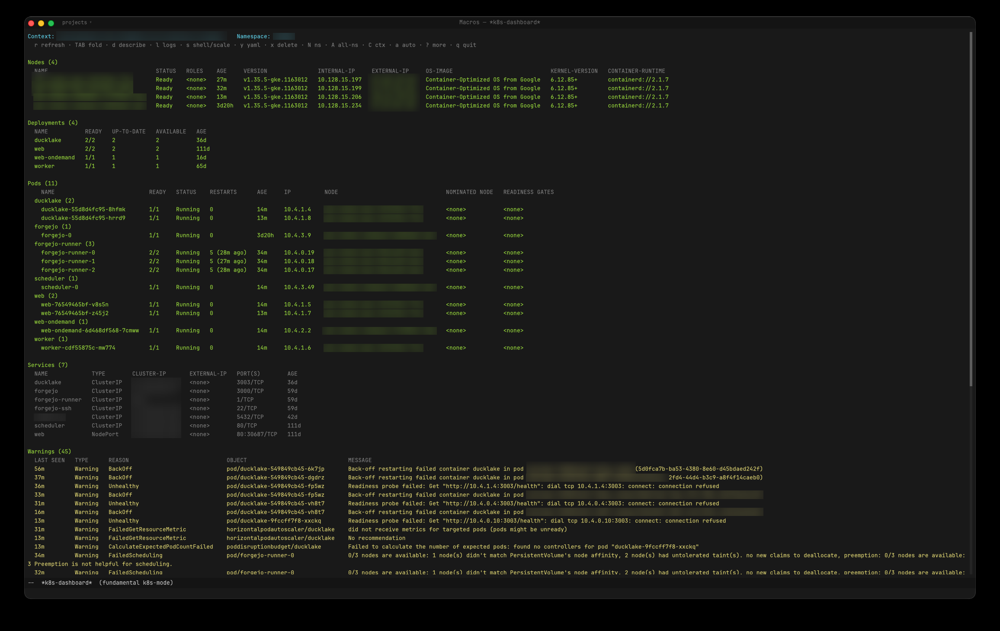

# macros-k8s

A Kubernetes dashboard for the [macros](https://github.com/kylegwinnup/macros)
editor, written in Steel — a magit-style porcelain for `kubectl`.

One read-only, foldable status buffer shows the current context and namespace at
a glance: nodes, deployments, pods (grouped by workload), services, and recent
warning events. Status is color-coded (green ok / yellow pending / red failing),
and point-and-key actions give you describe, logs, YAML, a pod shell, scale, and
delete without leaving the buffer.



The Rust core knows nothing about Kubernetes — the package sits entirely on the
same editor primitives magit and macros-jj use: `call-process` (run kubectl),
`lib-section` (foldable sections), `render-buffer`, `make-terminal` (the pod
shell), `lib-transient` (the `?` popup), and `run-with-timer` (auto-refresh).

## Requirements

- The [macros](https://github.com/kylegwinnup/macros) editor.
- `kubectl` on your `PATH`, already configured for a cluster (the dashboard uses
  your current context and its default namespace).

## Install

Add this to your `init.scm` — the package is cloned from git on first launch (the
entry file is `macros-k8s.scm`, so name it explicitly since the repo is
`k8s-dashboard`):

```scheme
(package-install "https://codeberg.org/macros-app/k8s-dashboard"
  'entry "macros-k8s.scm")
```

To use `/bin/sh` instead of the default `/bin/bash` for the pod shell, set it in
the package's `'config` thunk (runs after the package loads):

```scheme
(package-install "https://codeberg.org/macros-app/k8s-dashboard"
  'entry  "macros-k8s.scm"
  'config (lambda () (set-option "k8s-shell" "/bin/sh")))
```

The repo is cloned only when its directory is absent, so only the first launch
touches the network. Pin a version with `'ref "v1.0.0"` (a tag, branch, or
commit); it's re-checked-out on every launch, so bumping it in `init.scm` re-pins
on the next start.

## Launch

`M-x k8s-dashboard` opens the dashboard for the current kube context, in the
`*k8s-dashboard*` buffer (it resolves the context's default namespace on first
open).

The package adds **no global keybindings**. Bind it yourself if you want a key —
e.g. in `init.scm`:

```scheme
(define-key "fundamental" "ctrl-c k" 'k8s-dashboard)
```

## Keys

In the `*k8s-dashboard*` buffer:

| Key          | Action                                                                   |
| ------------ | ------------------------------------------------------------------------ |
| `r` / `g`    | refresh                                                                   |
| `TAB` / `RET`| fold / unfold the section (or workload/pool group) at point              |
| `j` `k` `n` `p` / arrows | move by line (your evil/helix motion works too)              |
| `d`          | `kubectl describe` the resource at point → `*k8s-describe*`               |
| `l`          | logs — the last `*k8s-log-tail*` lines (default 500)                      |
| `s`          | **pod:** open a shell (`exec -it`) in a half-screen terminal · **deployment:** scale |
| `y`          | `get -o yaml` the resource at point → `*k8s-yaml*`                        |
| `x`          | delete the pod at point (confirms first)                                 |
| `Y`          | copy the resource name at point to the clipboard                         |
| `N`          | switch namespace (completion)                                            |
| `A`          | toggle all-namespaces view (`kubectl -A`)                               |
| `C`          | switch context (`config use-context`, completion)                       |
| `a`          | toggle auto-refresh polling                                              |
| `?`          | actions popup for the resource at point                                 |
| `q`          | close the buffer                                                         |

`d`, `l`, `y`, `s`, `x`, and `Y` act on the resource on the current line — put
point on a pod, deployment, or node row. Nodes are cluster-scoped; everything
else acts in the row's namespace.

In the `*k8s-describe*` / `*k8s-yaml*` / logs buffers: `yy` copies the current
line, `Y` copies the whole buffer, `q` closes it, and evil/helix read-only motion
works.

## Grouping

**Pods** are grouped by their owning workload (Deployment / StatefulSet /
DaemonSet / Job) — each workload is a nested foldable subsection. Fold a group to
hide its pods, fold `Pods` to hide them all. A group heading is colored by its
worst pod, so a collapsed group still flags trouble.

**Nodes** group by node pool **adaptively**: if a recognizable pool label yields
two or more groups, each pool becomes a foldable subsection; otherwise nodes stay
flat (single-pool, kind, and minikube clusters aren't cluttered with a useless
wrapper). It auto-detects the cloud pool label — `eks.amazonaws.com/nodegroup`,
`cloud.google.com/gke-nodepool`, `karpenter.sh/nodepool`,
`kubernetes.azure.com/agentpool`, `agentpool`.

To group nodes by something else (an AZ or role, say), set the label option — or
change it live with `M-x k8s-set-node-group-label` (empty value = auto-detect):

```scheme
(set-option "k8s-node-group-label" "topology.kubernetes.io/zone")
```

Both grouping schemes are resolved without a JSON parser (Steel has none): pod
workloads come from a `custom-columns` query over `ownerReferences` (a
ReplicaSet owner collapses to its Deployment), node pools from `-L <label>`
columns. Deployments and services stay flat.

## All namespaces

`A` toggles between the single-namespace view and **all namespaces**
(`kubectl -A`). The header then reads `Namespace: <all>`, each section gains a
leading `NAMESPACE` column, and per-row actions (describe, logs, shell, scale,
delete) act in *that row's* namespace — not one dashboard-wide value. Picking a
namespace with `N` drops back to the single-namespace view. Nodes are always
cluster-wide.

## Pod shell

`s` on a pod splits the dashboard window in half (a terminal pane across the
bottom) and runs `kubectl exec -it <pod> -n <ns> -- <shell>` in it, with focus in
the shell. `C-x o` returns to the dashboard, `C-x k` kills the shell. The shell
defaults to `/bin/bash`; change it with the `k8s-shell` option (see
[Configuration](#configuration)).

On a **deployment**, `s` scales instead (prompts for a replica count), so the one
key does the sensible thing for whatever's under point.

## Logs

`l` on a pod opens the last `*k8s-log-tail*` lines (default 500) in a read-only
`*k8s-logs:<pod>*` buffer. It's a snapshot — press `l` again to refresh.

## The `?` popup

With point on a resource, `?` opens a transient menu of the actions available on
it — pods offer describe / yaml / logs / shell / delete, deployments offer
describe / yaml / scale, nodes offer describe / yaml. Off a resource, `?` shows a
view menu (refresh, namespace, all-namespaces, context, auto-refresh). Press a
key to run it; `q`, `Esc`, or `C-g` dismiss it.

## Auto-refresh

`a` toggles a self-rearming poll timer (`*k8s-auto-refresh-ms*`, default 5s). While
the dashboard is in front it refreshes normally, preserving point; while you're
in another buffer — reading logs, a describe, anything — it refreshes the
dashboard **silently in place** and never swaps focus back to it. Polling stops
when the dashboard buffer is closed or you toggle it off.

## Copying to the clipboard

Vim/helix `y` yank does **not** work in these buffers — it's a constraint of how
the editor overlays modal keys on special read-only buffers (magit and dired have
it too): only *motion* is layered on, so the visual `y` operator never runs and a
yank reaches neither the kill-ring nor the OS clipboard. macros-k8s binds explicit
copy commands instead, all via `clipboard-set` (so `cmd-v` in another app works):

| Buffer                 | Key  | Copies                        |
| ---------------------- | ---- | ----------------------------- |
| dashboard              | `Y`  | the resource name under point |
| describe / yaml / logs | `yy` | the current line              |
| describe / yaml / logs | `Y`  | the whole buffer              |

## Configuration

Two settings live in the editor's **option store**, so you can set them any time
(order-independent) with `set-option`:

```scheme
(set-option "k8s-shell" "/bin/sh")                          ; pod shell (default /bin/bash)
(set-option "k8s-node-group-label" "topology.kubernetes.io/zone")  ; node grouping ("" = auto)
```

The rest are Scheme vars — to change one, edit its default in `macros-k8s.scm`
(a pre-load `(define …)` in `init.scm` won't take; see the note below):

| Var                   | Default     | Meaning                          |
| --------------------- | ----------- | -------------------------------- |
| `*k8s-command*`       | `"kubectl"` | kubectl executable               |
| `*k8s-log-tail*`      | `500`       | log lines fetched by `l`         |
| `*k8s-auto-refresh-ms*` | `5000`    | auto-refresh interval (ms)       |

Faces are user-overridable — redefine after loading (and re-apply after a
`load-theme`, which wipes the palette):

```scheme
(set-face "k8s-err" "#ff5555")
```

Faces: `k8s-header`, `k8s-section`, `k8s-ok`, `k8s-warn`, `k8s-err`, `k8s-dim`.

> **Why the option store, not `(define *k8s-shell* …)`?** A loaded package is its
> own Steel compilation unit: its own `(define *foo* …)` shadows any value you
> `define` beforehand, and neither an external `set!` nor a direct call to a
> package function from `init.scm` reaches it (the function isn't defined yet when
> `init.scm` compiles). `set-option` sidesteps all of that — it writes the
> editor's Rust-side option map, which the package reads at use time.

## Notes / limitations

- kubectl output is parsed as **columnar text** (no JSON parser in Steel).
- Warning events use `--field-selector type=Warning`.
- Destructive actions (`x` delete, `s` scale) shell out through
  `call-process-full` and surface `kubectl` stderr in the echo area on failure.
- Logs are a static tail, not a live follow.

## License

MIT — see [LICENSE](LICENSE).
